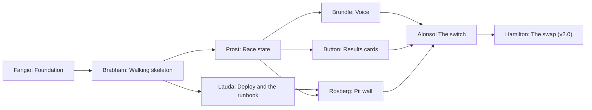

# Roadmap

Where Those Who Run v2 is going and in what order. The table under
[The order](#the-order) is the only place the order of the milestones lives.
The milestones and their issues are on
[`paddock`](https://github.com/those-who-run/paddock/milestones); each
milestone's issues are written when the one before it is nearly done.

Last reviewed 2026-10-22, when this file was first written, during Fangio.

## Principles

Carried from v1's
[roadmap](https://github.com/those-who-run/those-who-run/blob/main/ROADMAP.md):

1. **Own car only.** GT7 sends nothing about other cars, flags, penalties,
   weather or tyre wear. Every feature works from our own car's telemetry, or
   it is not on the list. One experiment steps outside it on purpose:
   Coulthard brings outside reference data (F1 sessions from OpenF1) into the
   pit wall as an optional plugin, read-only, and never into the engineer or
   its callouts.
2. **Voice first, eyes on the road.** In VR the engineer is the HUD: never
   talk mid-corner, never repeat the same sentence.
3. **Numbers before words.** Measurements are computed deterministically and
   tested on real recordings. AI only phrases, prioritises and answers, and
   never invents a number.
4. **Local first.** Everything runs on your own hardware; a cloud model is
   optional and off by default.
5. **Pinned by a recording.** A behaviour ships with a fixture from a real
   drive.

New in v2:

6. **Recordings are the referee for parity.** v2 is level with v1 when the
   same recordings, replayed through both, give the same laps, events and
   callouts. A difference is a bug in v2 until a recording shows v1 was wrong.
7. **Every feature is a subscriber that can fail alone.** A feature reads the
   events it needs from the bus and publishes its own. When it fails, it
   fails on its own: the rest of the system keeps running.

## Phases

1. **Parity.** Everything v1 does, on the v2 architecture, checked against v1
   with replayed recordings. It is split into small milestones, each ending
   with a demo: something the maintainer can run, see or hear. Parity ends
   with Hamilton, when v2 replaces v1.
2. **Features.** v1's planned features, recreated in v2 terms, plus the
   ephemeral environment for end-to-end tests. Each is filed early as a
   Feature issue and specced in full when its milestone comes up.

## Rules

- **The table below is the only place the order lives.** No milestone name
  carries a number, no milestone has a due date, and the project board has no
  order field. Moving a row is how the order changes; nothing else holds it.
- **The position column is the current position, not part of the name.** It
  changes whenever rows move and is not stored anywhere else.
- **Milestones are not versions.** Each component releases on its own, with
  its own version numbers. A milestone's description may say which component
  versions closed it, after the fact. "v2.0" is another name for Hamilton, not
  a tag on any repository.
- **A name is never reused,** even after its milestone closes. If a milestone
  is dropped, its name goes with it.
- **Parity or feature is a label** (`parity`, `feature`), not part of the
  name, so a milestone can change phase without a rename.
- **Names can change until work starts on a milestone,** and never after.

[ADR 0005](docs/adr/0005-milestone-names.md) records why milestones are
named after F1 drivers, and these rules with it.

## How the order works

- **Parity first, and nothing jumps it.** No feature milestone starts before
  Hamilton is done.
- **Features after parity are a pool, not a queue.** The next one is picked by
  value and use: what racing on v2 shows is missing, and what is worth most
  then. The rows are ordered only where one feature depends on another;
  otherwise their order is today's guess.

## The order

| # | Milestone | Phase | Outcome | Why the name |
|---|---|---|---|---|
| 1 | Fangio | parity | Foundation | The first great; everything after stands on him |
| 2 | Brabham | parity | Walking skeleton | Built his own car from nothing and won in it |
| 3 | Lauda | parity | Deploy and the runbook | Came back and raced again: redeploy from the runbook |
| 4 | Prost | parity | Race state | The Professor, who always knew the state of the race |
| 5 | Brundle | parity | Voice | The driver who became the voice of F1 |
| 6 | Button | parity | Results cards | Press the button, post the card, once |
| 7 | Rosberg | parity | Pit wall | Won on data and preparation |
| 8 | Alonso | parity | The switch | Switched teams more than anyone, and back again |
| 9 | Hamilton | parity | The swap (v2.0) | The big move late in a career |
| 10 | Verstappen | feature | Live dash | Flat out, live, now |
| 11 | Barrichello | feature | Session awareness | Started more races than anyone in his era, and saw every kind of session |
| 12 | Räikkönen | feature | Cockpit voice | Team radio: "leave me alone, I know what I'm doing" |
| 13 | Kobayashi | feature | Drift | Fearless, and sideways when it counted |
| 14 | Schumacher | feature | Setup and settings | Obsessed with the setup |
| 15 | Leclerc | feature | Live delta | Pole laps, where the delta is everything |
| 16 | Piquet | feature | Strategy | Won titles by thinking, not only by driving |
| 17 | Senna | feature | Corner coaching | Monaco, corner by corner |
| 18 | Piastri | feature | Debrief and progression | Calm debriefs, fast progression |
| 19 | Norris | feature | Conversation | Never stops talking |
| 20 | Vettel | feature | AI coach | Four titles, now the mentor |
| 21 | Ricciardo | feature | Dash designer | Style first |
| 22 | Stewart | feature | Ephemeral environment for end-to-end tests | Campaigned for safety when nobody else would |
| 23 | Coulthard | feature | F1 weekend: a pit wall plugin (experiment) | Went from the cockpit to the commentary box, and watches every race weekend |
| 24 | Häkkinen | feature | Observability: logs, metrics, NATS health and tracing | Said little on the radio, so the team read him from his data |

## Parity dependencies

The arrows are dependencies, not the order. Where two milestones don't depend
on each other, the table above decides which goes first.

## Parity milestones

### Fangio: Foundation

The ground every component stands on.

- `paddock`: the issue format and templates, the labels, the project board,
  the guardrail docs, this roadmap and the first ADRs (the v2 architecture,
  the contracts, the store, v2 beside v1, the milestone names).
- The organisation's `.github`: the shared agent guard, reusable workflows,
  default community files and the script that protects each repository.
- A Go template repository with CI, commit hooks, the agent guard, the agent
  rules, dependency updates, releases and image builds built in.
- `contracts` v0.1: the frame, `session.started`, `lap.completed` and
  `session.ended`, with lint and breaking-change checks, Go generation and the
  list of subjects.
- Guardrails at the starting level, as [`docs/guardrails.md`](docs/guardrails.md)
  lists them: an agent identity of its own, rulesets that need the
  maintainer's approval, and the release environment with a reviewer.

**Demo:** a new repository made from the template passes CI, and an agent's
pull request on it cannot merge without the maintainer's approval.

### Brabham: Walking skeleton

The thinnest path from a recording to stored laps.

- `salsa` decodes GT7 packets from recordings, with fixtures from v1's
  recordings.
- `ecu` tracks enough race state for session start and end and laps, and
  publishes frames and the three events on NATS.
- `logbook` subscribes and stores each lap.
- A replayer and the parity harness: one recording through v1 and v2, the
  laps compared.
- A compose file in `paddock` that runs NATS, `ecu`, `logbook` and the
  replayer on a laptop.

**Demo:** a clean race, and a race with a pit stop and a restart, replayed;
lap count, lap times and fuel per lap match v1.

### Lauda: Deploy and the runbook

The base for deploying v2 anywhere, and the steps to do it again from
nothing.

- NATS with JetStream and WebSocket, and a job that creates the streams and
  KV buckets.
- A kustomize base in `paddock` for the components, and a private overlay
  that sets what differs per environment (host names, storage, secrets, the
  namespace, replica counts). The base assumes no particular cluster.
- A runbook in `paddock`: from an empty cluster to running, redeploy,
  upgrade, roll back and remove; how to write a private overlay, with
  placeholders such as `<host>` and `my-cluster`; secrets by name and key,
  never by value.
- A smoke check as a job in the base, so any environment can run it.

**Demo:** the skeleton running in a cluster beside v1, fed by replays, with
`nats sub 'twr.>'` showing the events from a laptop. Then the whole stack
rebuilt from the runbook alone.

### Prost: Race state

Everything v1's engine detects, as events and callouts.

- The start check, joining part way, continuing after a restart, pauses, pit
  entry and exit, teleports, track detection, session kind, final lap,
  position, the finish (flag and timed), race end and telemetry lost.
- The built-in rules in `ecu`, raising callouts.
- The live state that v1's status route gives today, in a KV bucket.
- Logs, metrics and NATS monitoring from the start.

**Demo:** every v1 recording replayed; v2's events and callouts diffed
against v1's, with no difference.

### Brundle: Voice

- `radio` speaks callouts through Piper into Discord, as a second bot in its
  own channel, with v1's pit-lane policy, and drops callouts that have
  expired.
- A WAV or console mode for replays.

**Demo:** a replayed race spoken in Discord by the v2 bot, callout for
callout as v1.

### Button: Results cards

- A subscriber to `session.ended` posts the session's results card, exactly
  once: posted sessions are kept, so a redelivered event posts nothing.
- The subscriber is `podium`, posting over Discord's REST API
  ([ADR 0010](docs/adr/0010-results-cards.md)).

**Demo:** a replayed race posts one card, and a redelivered `session.ended`
posts nothing.

### Rosberg: Pit wall

- `pitwall`: v1's web app moved over with its history, on a Go API over
  `logbook`.
- Lap compare, the track map and the race story working on v2's data.

**Demo:** the pit wall on a phone showing v2's sessions.

### Alonso: The switch

- A switch in the deployment between v1 and v2, with the idle gate on both
  sides, so a switch never cuts into a race.
- `ecu` listening to the PS5 for real.

**Demo:** switch to v2, race on the PS5, switch back to v1.

### Hamilton: The swap (v2.0)

- Race on v2 for a while, with v1 one commit away.
- Then v1's deployment is removed, and v1's repository is renamed
  `parc-ferme` and archived.

**Demo:** a week of racing on v2 with nothing missing.

## Feature milestones

Each is specced in full when it comes up.

- **Verstappen, Live dash:** the wheel dashboard straight off NATS over
  WebSocket.
- **Barrichello, Session awareness:** every session kind recognised from
  recordings.
- **Räikkönen, Cockpit voice:** the engineer as the HUD in VR.
- **Kobayashi, Drift:** detection, callouts and results.
- **Schumacher, Setup and settings:** settings in a KV bucket, and PS5 and
  Discord setup.
- **Leclerc, Live delta:** distance along the track, reference laps, live
  delta and corner names.
- **Piquet, Strategy:** tyres, fuel saving, and whether to stop now or later.
- **Senna, Corner coaching:** corner by corner against your own best.
- **Piastri, Debrief and progression:** debriefs, personal bests, growth and
  export.
- **Norris, Conversation:** questions in Discord and by voice.
- **Vettel, AI coach:** a coach and asking it questions, starting as an
  experiment.
- **Ricciardo, Dash designer:** design your own wheel dashboards.
- **Stewart, Ephemeral environment for end-to-end tests:** a safeguard; the
  whole system in a throwaway cluster, a recording replayed through it, and a
  pull request that breaks a contract goes red before review. Lauda's
  portable base is what makes it possible.
- **Coulthard, F1 weekend (experiment):** the pit wall's first plugin. An
  optional component fetches F1 sessions from OpenF1 within its rate limit and
  caches them, and the pit wall gains a Weekend section: classification, tyre
  strategy, lap charts and driver telemetry, and a GT7 lap against an F1 lap at
  a circuit both share. It tests how an outside source plugs into the UI
  without touching the engineer, and stays an experiment until it earns more.
- **Häkkinen, Observability:** ecu's structured logs, metrics against the frame
  budget, NATS stream and consumer health with a dashboard and alerts, and a
  decision on tracing across the bus. The stack tells you what it is doing
  without anyone reading code.

## Experiments

Experiments run alongside any milestone as `shakedown-<name>` repositories
that subscribe to the bus. They are not milestones and keep their
`shakedown-` names; one that proves itself becomes a feature with a milestone
of its own.

## Open questions

- Are these the right drivers for each milestone? See [Rules](#rules) for
  when a name can still change.
- Is anything missing from parity? v1 has three things no parity milestone
  names yet: the archive of outing recordings (v1's
  [ADR 0002](https://github.com/those-who-run/those-who-run/blob/main/docs/adr/0002-outing-archive.md)),
  the Prometheus metrics, and the control API v1 planned but never built.
